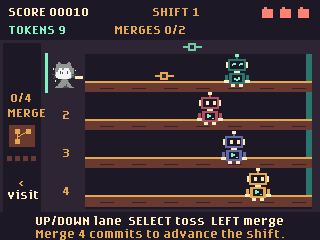

# Token Tapper

Token Tapper is a four-lane arcade game where Mona serves AI tokens, catches commits, and completes merge goals to finish each shift.



## How to play

You are Mona tending the token bar on the left. Patrons walk in from the
right as little coding-agent bots with antennae, glowing faceplates, and
terminal chest panels; toss them mint-green AI tokens to serve them once and send them
completely off-screen. Even a patron close to Mona leaves after one delivery.
Served agents light up mint-green eyes and a chest checkmark as they head out.
Every delivery makes a little Git commit symbol pop above the recipient,
drift upward and sideways, and fade away. At the exact same time, a gold commit shoots back
along the lane: catch it by being in that lane when it reaches Mona. Patrons
send their commit before departing and cannot receive another token on the way out.

| Control | Action |
| --- | --- |
| Up / Down | Switch lanes; hold to keep moving |
| Select at the bar | Spend one token to toss it; start or restart a shift |
| Left | Visit the merge station beside the bar |
| Select at the station | Merge four caught commits toward the shift goal |
| Right | Return to the same serving lane; cancel an unfinished merge |
| Back / Menu | Pause or resume |
| Select while paused | Resume without tossing |
| Back on the results screen | Return to the title |
| Select between shifts | Start the next shift with a fresh token budget |
| Home | Return to the badge menu |

## Tokens, commits, and merges

**Merging is how you finish a shift.** The top HUD shows completed merges
against the goal, rather than collected commits. The merge station shows your
commit stash and four readiness lights.

Each toss spends one token; each delivery produces one returning commit.
Catch four commits, press Left to visit the station, then Select to merge
them over 0.8 seconds. Each completed merge earns **50 points**, advances
the shift goal, and replenishes **four tokens**. Right cancels an unfinished
merge without spending commits and returns Mona to her previous lane.

Starting token budgets are **four per required merge, plus two spares**;
merge refills give you additional room for defensive serving:

| Shift | Required merges | Starting tokens |
| --- | --- | --- |
| 1 | 2 | 10 |
| 2 | 3 | 14 |
| 3 | 4 | 18 |
| 4 | 5 | 22 |
| 5 onward | 6 | 26 |

Two spare tokens allow two dropped commits without making the goal
unreachable; a third dropped commit ends the three-life game. Your stash holds
only four commits. Catching another while it is full loses that commit and
deducts **10 points** (score cannot fall below zero), with the warning
**"Commit lost! You need to merge!"** No life is lost and no token is refunded.
You can still serve agents defensively to keep them away from Mona, but must
merge before banking more commits. Normal catches earn 5 points.
Departures and catches alone never advance the shift.

**The bar stays live while you visit the station.** Mona cannot toss, change
lanes, or catch commits there. A dropped commit costs a life but does not
cancel a merge, eject Mona from the station, or reset your resources.
At zero tokens, you can still catch outstanding commits and merge, but you
cannot fire. Floating symbols above patrons are delivery effects, not extra
currency.

## Clearing out and the next shift

Completing the required merges closes the bar: arrivals stop, all remaining
patrons head fully off-screen, and outstanding tokens/returns are cleared
without penalties. Mona cannot serve or merge during this safe clear-out.
Unserved patrons do not earn departure points.

Once everyone has left, the **SHIFT COMPLETE** screen waits for Select,
giving you a real breather. It previews the next shift's goal and token
budget. Select starts that shift without throwing a token. Tokens refresh
to the new budget; spare tokens and unmerged commits do not carry over.
Lives, score, and total merges do carry over. Later shifts increase the
patrons' speed and arrival rate; after shift 5 the goal stays at six merges.

The Git metaphor is deliberately arcade-sized: patrons create commits, Mona
collects the proposed work, and the station merges a batch into the main branch.
Commits are incorporated, not literally destroyed; the counter tracks work still
waiting to merge. Finishing the merge quota completes the work for the shift;
the fresh token budget and merge refills are arcade resource rewards, not
something Git itself produces.

## Lives and server overload

You have **three lives**, with different consequences for each mistake:

| Mistake | Consequence |
| --- | --- |
| Drop a returning commit | Lose one life per commit; everything else keeps running, including an active merge. Collected commits and token stock are preserved. |
| Let an unserved agent reach the tap | Lose one life; a **Too many agents** overlay freezes the visible bar for a **3-second countdown**, then automatically resumes. |
| Toss a token off the end without serving anyone | Lose one life and reset the bar, as before. |

Agents already at the tap together count as **one crowd-overload incident**:
they are all removed for one life total, not one life per agent.
Overloads preserve everyone else,
outgoing tokens, returning commits, supplies, caught commits, and active merges.
All gameplay timers freeze during the countdown, including merge progress.
Back/Menu can pause the countdown; resume continues from the same time.
The last life still ends the game rather than resuming.

Wasted-token resets clear the bar, cancel any active merge,
and discard unmerged commits. **Completed merges in this shift are kept**.
The server restocks only for remaining work: four tokens per unfinished
merge, plus two spares.
Dropping a commit does **not** trigger this reset. The last life always ends
the shift immediately, even during a merge; no unfinished merge reward is given.
Completed merges and score remain counted.

A delivery earns 10 points, sending a served patron out the door earns
another 25, catching a commit earns 5, and finishing a merge earns 50.
There is a short toss cooldown, so make each press count rather than firing
blindly. The best score is saved when all lives are lost.

The opening pace uses 260 pixels/second for tokens and 220 for departing agents.
Each gold commit independently picks one steady return speed from
**108, 114, 120, 126, or 132 pixels/second**: five subtle paces centered on the
previous 120-pixel/second speed. Agents advance at 16 pixels/second initially,
with the second arrival after 1.4 seconds and subsequent arrivals about every
2.15 seconds at shift 1. Tosses have a 0.28-second cooldown. Delivery starts the
floating effect, the gold return, and the patron's departure immediately,
without waiting for any animation to finish.

## Requirements

GitHub Universe 2026 badge; no Wi-Fi, credentials, extra hardware, or network
services. Uses the orientation-aware controls and the 320x240 display mode.
Home exits immediately; an unfinished shift is not saved.

## Development

Run the rule tests from the repository root:

```sh
python3 -m unittest discover -s tests -p 'test_token_tapper.py'
python3 .github/skills/hyb26-skill/scripts/validate_app.py badge/apps/token_tapper
python3 .github/scripts/validate_app_readmes.py badge/apps
```

## Credits and licensing

The app code, coding-agent drawings, and menu icon were created for Token
Tapper. Mona's animated sprite sheet is reused from this repository's
`badge/apps/merge_conflict/mona-default.png` and bundled locally so the game
does not depend on other installed apps. The repository's MIT license credits
Pimoroni & GitHub; see [LICENSE](../../../LICENSE). Mona is a GitHub character;
reuse of the repository asset does not grant separate trademark rights.
No artwork, code, or audio from the original Tapper game is included.
The gameplay screenshot was captured in the Universe 2026 Badge Simulator.

## Verification

The focused suite covers the game rules and badge frame loop, including
simultaneous crowd overloads and an in-flight wasted shot cancelling a merge.
The static app validator and repository-wide README validator pass.
Simulator checks cover serving and catching, agent departures, merge quotas
and refills, lost-commit penalties, safe shift transitions, and the overload
countdown with state preservation. These checks do not replace physical testing.

In the Badge Simulator, check the title, Mona, all four lanes, token collisions,
floating commits and simultaneous gold returns at varied speeds, lost extra catches,
catching and missing, zero-token feedback, station entry/exit, merge completion
and cancellation, pause during a merge, drops without merge interruption,
last-life drops, patrons departing fully after a single token, the overload
countdown overlay, remaining-work budgets, merge token refills, safe shift clear-out, the between-shift break,
next-shift token refresh, three-life game over, restart, and rotated controls.
The simulator is not
proof of hardware compatibility: physical testing remains outstanding. On a
physical badge, also verify the menu
icon, Home/reopen, both orientations, and best-score persistence after reboot.
